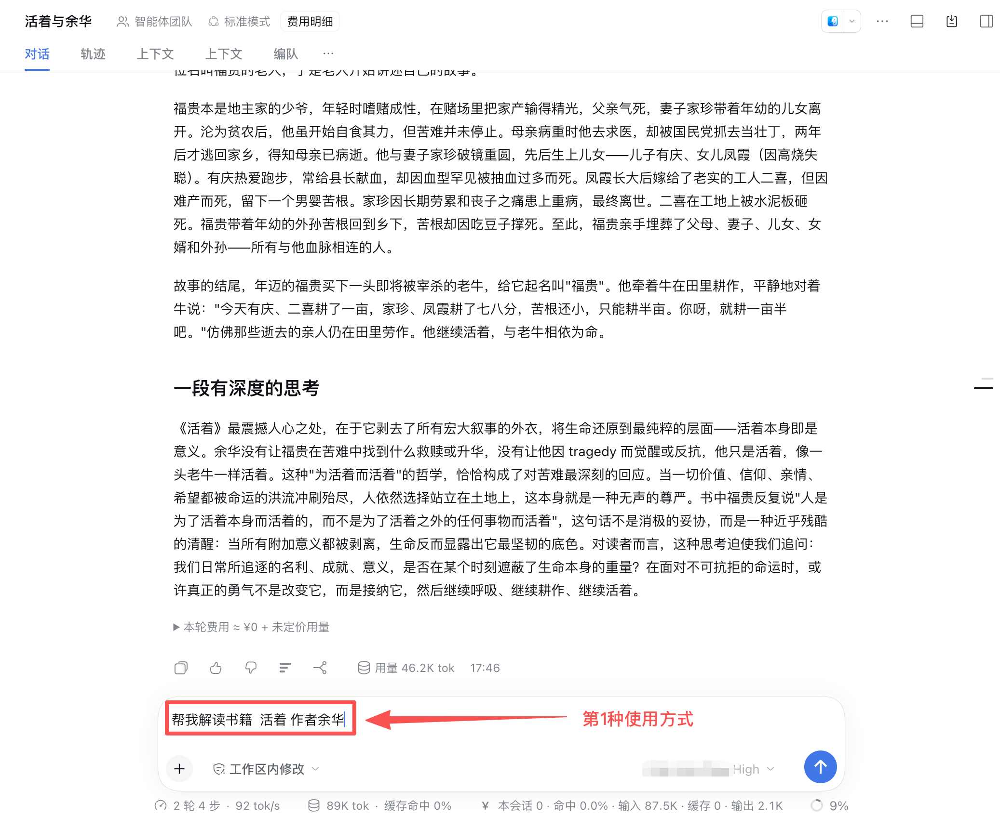
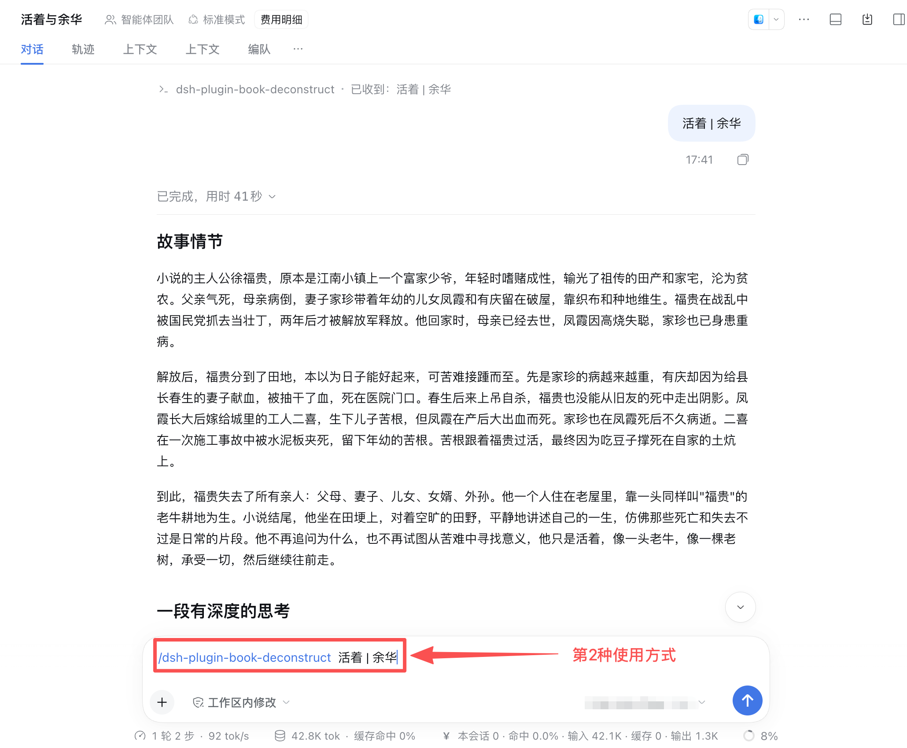

# dsh-plugin-book-deconstruct

> GitHub：`zmz123612/dsh-plugin-book-deconstruct`

DeepSeek Harness **Host 插件**：装进 profile 后会出现在插件列表，**任意会话**都可用：

# 好用的书籍拆解工具

- 使用方式： `帮我解读书籍 xxx  作者xxx` 或者 `/dsh-plugin-book-deconstruct 书名 | 作者`
- 工具：`dsh-plugin-book-deconstruct`（智能体在对话里调用）


## 使用方式截图

### 第一种使用方式



### 第二种使用方式




## 输出两段：

1. **故事情节** — 讲清整本书（不是一句话短评，也不灌水）
2. **一段有深度的思考** — 只写一整段

## 安装

从 npm（推荐）：

```sh
dsh plugin --profile desktop add dsh-plugin-book-deconstruct
```


从 GitHub：

```sh
dsh plugin --profile desktop add github:OWNER/dsh-plugin-book-deconstruct
```

装完后**完全退出并重新打开** DeepSeek Harness。


## 配置（可选）

在 profile 的 `cordis.patch.yml` 按行 id `dsh-plugin-book-deconstruct` 覆盖：

```yaml
- id: dsh-plugin-book-deconstruct
  name: dsh-plugin-book-deconstruct
  config:
    provider: ''   # 与 model 成对；空则用默认模型
    model: ''
```
